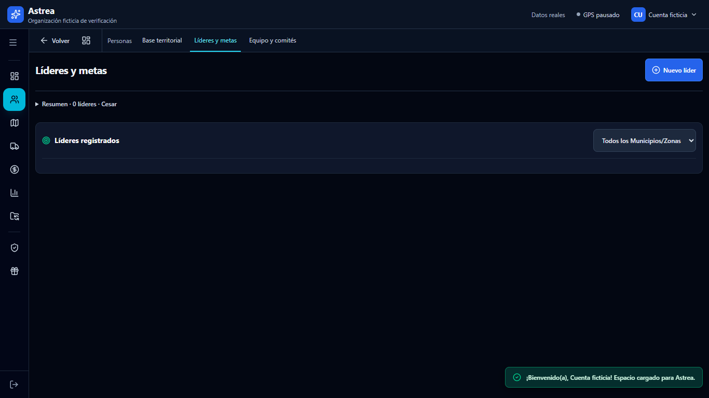
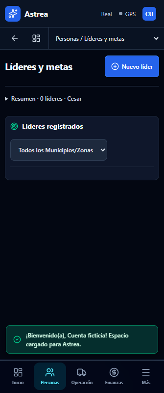
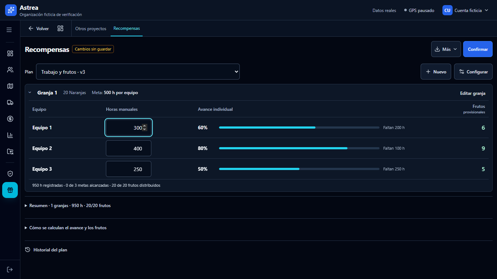
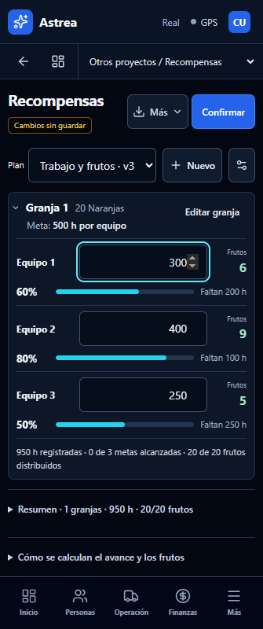

# Interfaz compacta y recompensas: ejecución del 16 de noviembre de 2026

El usuario aprobó la propuesta visual antes de desarrollar. Se mantuvieron el tema oscuro, los permisos, los espacios de trabajo y el regreso por el recorrido real.

## Resultado

- Cabecera de 56 px y barra contextual de 45 px: 101 px en conjunto en escritorio y móvil. El tablero usa solo la cabecera. Las capturas anteriores mostraban aproximadamente 450–550 px de elementos repetidos antes del contenido; esa cifra anterior es una estimación visual.
- Cuenta, organización, GPS y modo real/prueba se reúnen en la cabecera. Se retiraron la bienvenida de cada módulo y los encabezados de marca duplicados. Los pendientes, conflictos y errores siguen visibles.
- Las secciones usan pestañas en escritorio y selector en móvil. Finanzas comparte esa navegación; no añade otra barra duplicada. Resúmenes, planificación, ayudas y filtros extensos se despliegan a petición.
- Recompensas tiene una sola captura de horas manuales, una meta completa por equipo y reparto de toda la producción por esfuerzo relativo. Confirmar certifica esa versión del plan y no almacena otra copia de horas.
- Los planes anteriores requieren revisar discrepancias entre horas manuales y confirmadas. Se archivan el plan anterior y su confirmación en un historial inmutable antes de guardar la nueva versión. Las asignaciones automáticas no se convierten en trabajo realizado.
- Excel conserva ceros y casillas vacías por separado, tiene una meta por equipo y granja y utiliza el mismo reparto con restos mayores y desempate estable.
- Se corrigió el acceso móvil a Configurar, la edición de valores inválidos sin perder el campo y la pantalla territorial vacía cuando aún no hay candidaturas.

## Regla comprobada

| Equipo | Horas manuales | Meta individual | Avance | Frutos de una producción de 20 |
| --- | ---: | ---: | ---: | ---: |
| 1 | 300 | 500 | 60 % | 6 |
| 2 | 400 | 500 | 80 % | 9 |
| 3 | 250 | 500 | 50 % | 5 |

Las 950 horas agregadas no convierten las tres metas en cumplidas. Sin horas no se reparten frutos. Las horas adicionales siguen contando. Con un solo equipo con esfuerzo positivo, ese equipo recibe la producción completa. El GPS no certifica trabajo.

## Evidencia

- Pruebas de cálculos, límites, conversión y plantillas; guardado y confirmación con reglas reales de Firebase, recarga, historial y rechazo de una sesión desactualizada.
- Pruebas autenticadas con datos ficticios en anchos de 335 y 1366 px: doce listas principales cargadas, navegación, regreso, inicio, configuración interior y teclado. Sin errores de página ni desbordamiento horizontal en las pantallas inspeccionadas.
- La captura de horas comienza aproximadamente a 319 px en móvil y 337 px en escritorio en la configuración probada; no se alcanzó el objetivo inicial de 180–220 px en Recompensas. Sí se ven sus tres equipos en la primera pantalla móvil y la navegación ocupa 101 px.
- El historial muestra las últimas veinte versiones; las anteriores se conservan. Las consultas de planes se limitan a 10.000 y avisan cuando la lista puede estar incompleta.
- Android 1.3.0, código 12: se prepara con la firma existente y comprobación del paquete. La publicación y el archivo se consultan en [versiones de Astrea](https://github.com/elchowi31/astrea-suite-electoral/releases).

[Astrea en producción](https://astrea-suite-electoral.vercel.app).

## Capturas de la aplicación

Los nombres y datos corresponden a una organización ficticia de verificación.

Se conserva el plan gratuito. TTL automático y recuperación histórica PITR siguen pendientes por decisión expresa del usuario. WhatsApp conserva el servicio abierto Baileys y su recepción con la pestaña activa. No se enviaron mensajes de prueba a terceros.
